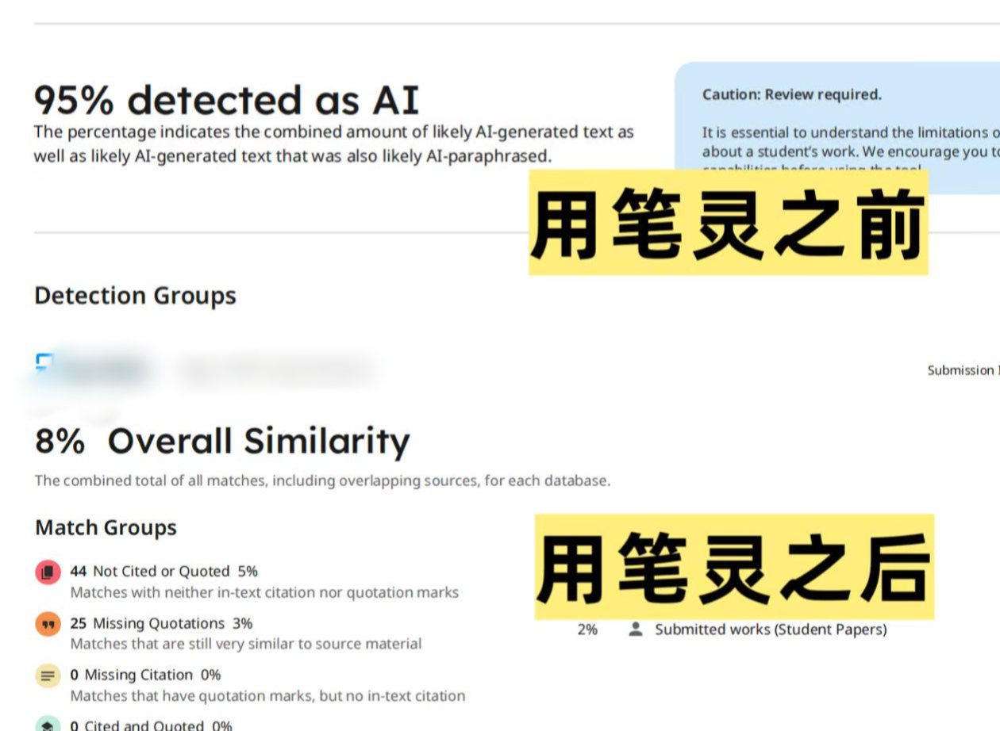
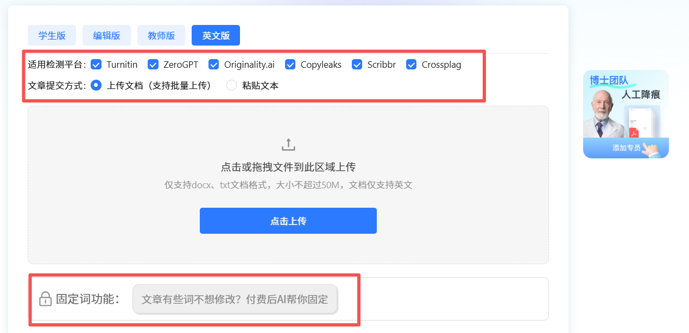

# 英文AI率太高怎么办？5个技巧 \+ 工具实测，教你如何科学降AI率！

很多小伙伴在长期打磨英文长文时，都会遇到一个很尴尬的问题：明明是自己花大量时间查阅资料、一点点整理撰写出来的内容，拿去做文本检测之后，却显示存在明显的 AI 文本特征。

不少人的第一反应就是到处找**免费降 ai 率工具**，翻找网上各式各样**降 ai 率的方法**，但忙活大半天，花费大量时间精力，文稿读起来依旧生硬别扭，文本模板感还是很重。

我也是一样，试过单纯同义词替换、分段改写等各种网传办法，效果都时好时坏，直到现在我慢慢摸索清楚了，整理了一套非常适合新手的实操优化技巧，搭配多款热门工具实测对比，帮大家高效**降低 ai 率**，把文稿的阅读质感提上来。

## 一、为什么你的 AI 痕迹一直很重

很多人以为只要把句子里的单词换成近义词就行，其实搞错重点了呀，现在 AI 模型产出文本的写作特点是很固定的：句式长度均匀、逻辑过渡过于规整、缺少个人思考细节。

要是只替换单词，句子底层的行文结构、段落节奏没变，**降 ai**效果微乎其微，这也是很多人反复改稿，最后检测结果依旧不理想的根本原因。

如果想要真正改善，核心要从句式、细节、表达习惯这几个维度入手。

## 二、5个零基础可用的英文文稿优化技巧

### 技巧 1 打乱信息语序，重构段落逻辑

不要直接照搬原句的信息结构。读完一整个段落，吃透里面的核心观点之后，放下原文，打乱信息的先后顺序重新组织表达。

### 技巧 2 增加过程性、描述性细节

AI 写内容习惯直接抛出结论，文字偏向概括总结，缺少过程描述。我们可以适度加入操作过程、对比细节、分析思考这类内容，增加真人写作的痕迹，自然**降低 ai 率**。

举个简单例子：

原句：The data supports this hypothesis\.

优化后：After multiple rounds of cross\-checking between control and experimental groups, the collected data provides reliable support for this research hypothesis\.

增加了实验分组核验的细节，文本的个人写作感会明显变强。

### 技巧 3 长短句穿插，打破均匀句式

我们还可以手动拆分冗长的长句，也可以把零散短句适度合并，制造长短错落的语感，大幅弱化 AI 风格。

### 技巧 4 替换模板化过渡词

AI 有一些高频复用的固定衔接短语，如果对稿件比较熟悉，只要通读全文，就可以把这类通用性极强的过渡表达替换掉，减少模型一样的句式，**降低 AIGC 率**。

### 技巧 5 加入轻微个人化表述

最后一个小技巧，在写文章的时候，我们可以在不影响文稿专业性的前提下，加入自己的分析视角、研究判断，让文本带上属于自己的思考痕迹，不再是冷冰冰的模板文字\~

## 三、多款文本优化工具实测盘点

前面这几套手动优化思路，适合少量段落调整，如果文稿篇幅很长，纯手动修改会耗费大量时间，这段时间我测试了另外几款不同类型的文本优化工具，也在这里客观记录一下使用感受。

### 01、笔灵 AI

传送门： [https://u\.ibiling\.cn](https://ibiling.cn/paper-pass/english?from=githubywjiangai1009jw) 

笔灵是我实测之后最适配英文长文稿的**降 ai 率工具**，我有一个 AI 特征偏高的章节，优化之后复测，文本自然度提升明显，算是我浏览各类线上站点里体验不错的一款。

我实测下来发现，有很多非母语小伙伴撰写英文文稿时的语义没问题，但语句衔接生硬，我也是一样，在这种情况下，笔灵优化后的文本会更贴近真实的英文写作语感，阅读感受就会更自然。

还有一个固定词锁定功能，我用下来觉得特别实用，我们可以提前把专业名词、实验数据还有核心论点锁定，工具只会优化语句的语感，不会改动这些关键内容，这样一来我们就不用担心专业信息出错啦！

而且它修改完之后原稿表格、注释、段落排版都能完整保留，不用额外花费时间调整格式，我们可以省下反复调整文稿和排版的精力，把重心放在内容打磨上了\~

对时间比较紧张的人和懒人来说非常友好了嘿嘿！

### 02、QuillBot

传送门：[https://quillbot\.com/](https://quillbot.com/)

很多小伙伴查找线上文本优化站点时，经常会看到 QuillBot，界面简洁易上手，主打单句词汇与语序调整。

我拿摘要段落进行测试，用来微调短句效果还不错，免费版本存在单次字数上限，高阶改写功能需要付费解锁。

实际试用下来，我觉得它的短板在于缺少全局逻辑把控，如果把整篇长文稿放入改写，大多只是替换同义词，段落前后逻辑容易脱节，改写长难句时偶尔曲解原本含义，比较适合零散短句微调。

### 03、SpeedAI

传送门：[https://speedai\.fun/](https://speedai.fun/)

它是综合类的文字辅助工具，自带文本优化模块，用来微调短句、提升文本自然度还不错，使用也算比较简单方便了，属于基础可用的辅助工具。

不过我发现，它可能有一点不适配多平台的算法，要是稿件需要使用多个检测系统交叉核验的话，在经过 SpeedAI 调整后，文本AI率依旧会比较高，只有某单一平台的数据比较漂亮，我建议大家用它针对单平台做简单微调。

### 04、DeepL Write

传送门：[https://www\.deepl\.com/zh/write](https://www.deepl.com/zh/write)

不少人会把 DeepL Write 当作**免费降 ai 率工具**使用，它的优势在于修正中式英语，理顺语句语序，我在方法章节做过实测，语法润色能力不错，但是改写策略相对保守，模板感较重的段落大多只微调介词或者个别词汇。

一般来说，这样的改写风格就注定了它底层句式结构改动会比较小，文本优化幅度有限，更适合搭配主力**降 ai 率工具**，在后期做语句润色哦\~

## 四、我的一点感受

想高效优化文稿质感，不建议单一依赖免费工具，因为各类免费工具大多能力有限，单独使用很难达到理想效果。

英文文稿优化的核心目标是改掉模板化句式，增加真人写作痕迹，我们只要找对**降 ai 率的方法**，搭配合适工具组合，沉下心针对性调整，一定可以打磨出自然流畅、AI 痕迹低的优质文稿的！希望这一篇文章可以帮助到大家\~

